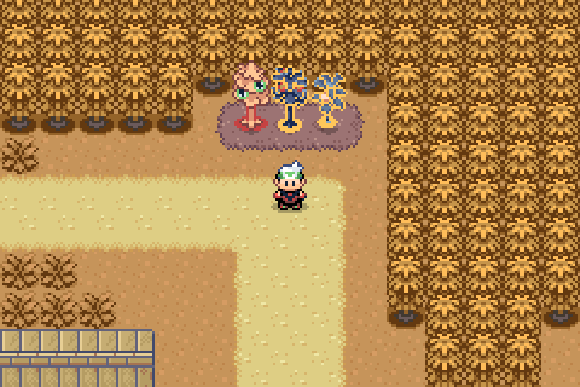
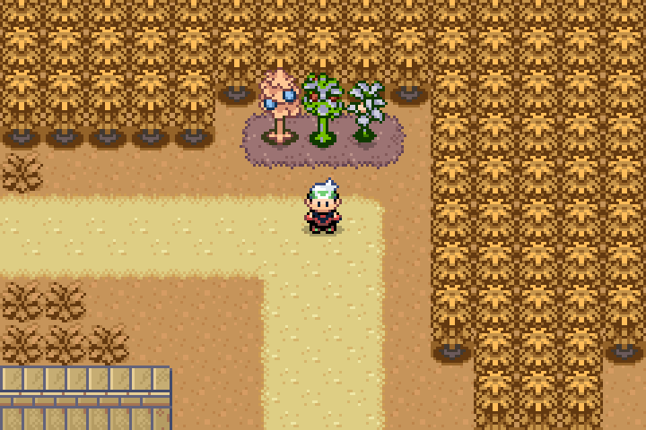
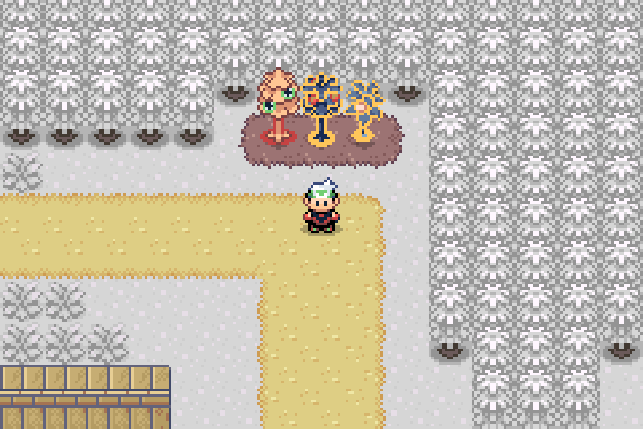
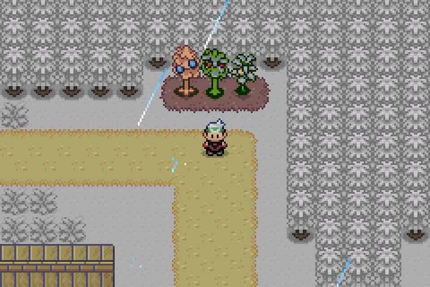

# Berry plant palette repair preview

Actual mGBA frames from compiled Emerald Legends v0.0.78 source, with a controlled Route 104 fixture. Before uses the shipped game; after includes the palette lookup repair. Frames are enlarged 3× with nearest-neighbor sampling. No map or sprite pixels were edited.

The berry table's original palette slots 2–5 were incorrectly treated as registry indices. Four private player palettes precede the NPC palettes, so berry plants loaded player/underwater colors. The repair resolves original NPC palette tags, independent of registry ordering. This affects every season, not only autumn and winter.

| Season | Before | After |
| --- | --- | --- |
| Autumn |  |  |
| Winter |  |  |

All seven growth stages in all four seasons passed native unfaded OBJ palette checks. See `results.json` for the tested ROM hash and 28 scenes. All 45 shared berry palette tables contain valid original slots for seven stages. Existing season-module regressions passed. No save layouts, plant timers, harvest rules, seasonal terrain, character palettes or map data changed. Owner approved these visuals on November 13, 2026. Integrated v0.0.80 release checks are tracked separately; these captures retain their original v0.0.78 provenance.
