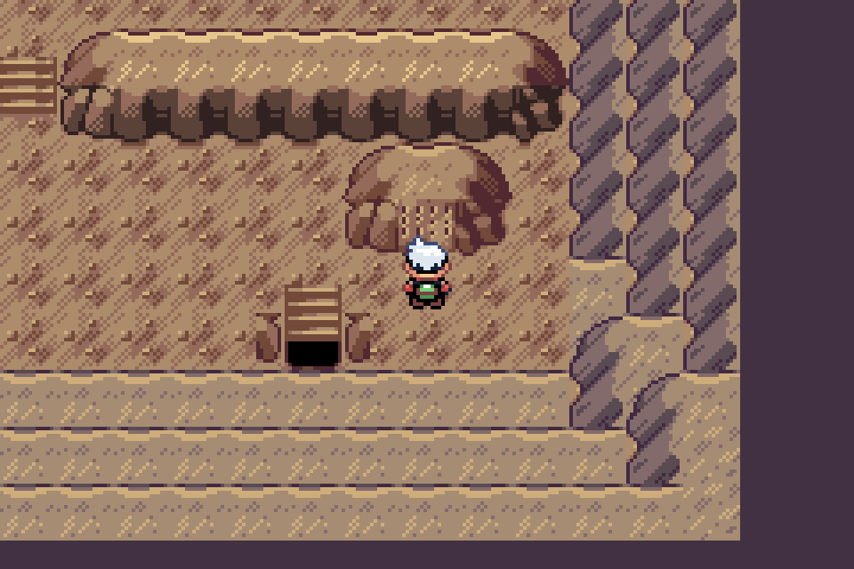
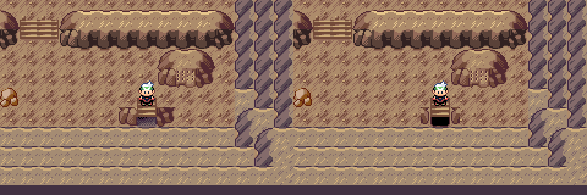

# Compact lower exit cleanup

Superseded side rocks: the owner identified the cropped outlines in this pass. See the [complete native rock correction](../whole-exit-rocks/README.md). The approved stair/recess and all other changes remain intact.

Owner approved the interior encounters, larger Regidrago, unique lore and upper mouths at 5645e36c, with only this lower-exit detail remaining. Replaced its mismatched grey checker shade with the native brown Cave 0x206 recess, and replaced bulky side caps with compact symmetric native stone returns on matching floor. Existing tread pixels, south-arrow behavior, warp indices/coordinates and every collision/elevation word are exact. No new pixels/palettes. The same lower-exit component is coherent across the descent; the sanctuary shares its recess.

Before, left; after, right. Both are genuine matched native camera frames.

Debug, focused existing source checks and full native mGBA walking/doorway/party-gate/retry/capture/flash/report/wild-encounter checks passed. Upper-mouth and larger-Regidrago images remain RGB exact. The matching full-frame difference is confined to the 48×16 lower-exit footprint. Authoring reproduces byte-exact from approved source and refuses changed owner inputs before writing. [Bound source/native receipt](../../../qa/wyrmtide-exit-cleanup.json).

Actual mGBA 0.10.2 footage, v0.0.70 plus unshipped Wyrmtide Debug. Exact nearest-neighbor 4x exports; the matched comparison is 3x. Prior Release/LTO and compiler-setup limitations remain; this is not Release/BPS readiness. New exit awaits review; all other owner approvals carry forward. Keep PR #89 draft and public v0.0.75 unchanged; preserve later Porymap edits.
