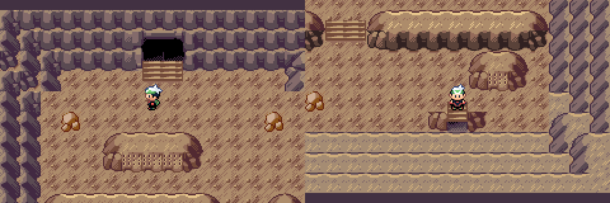
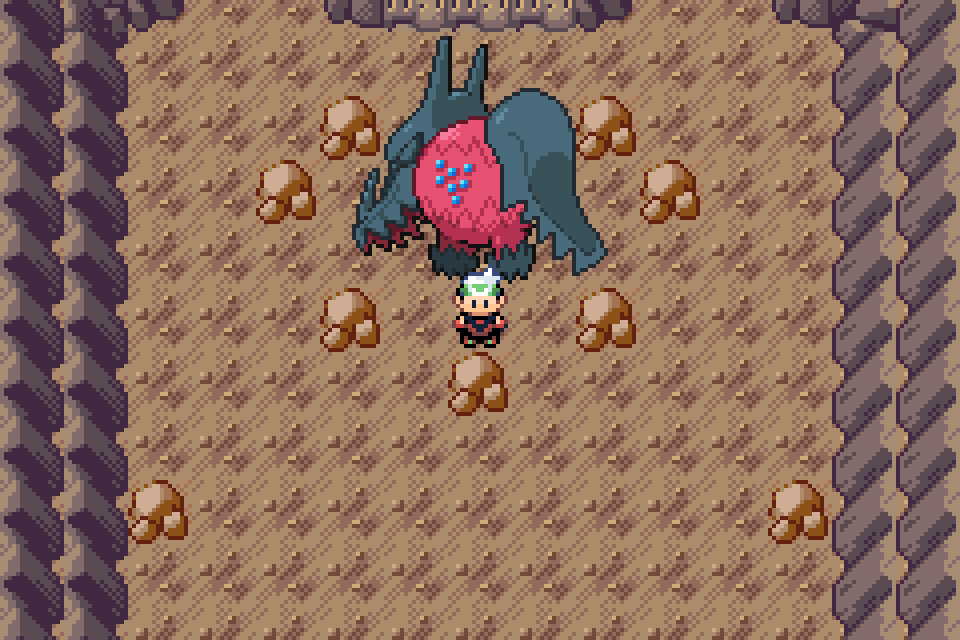
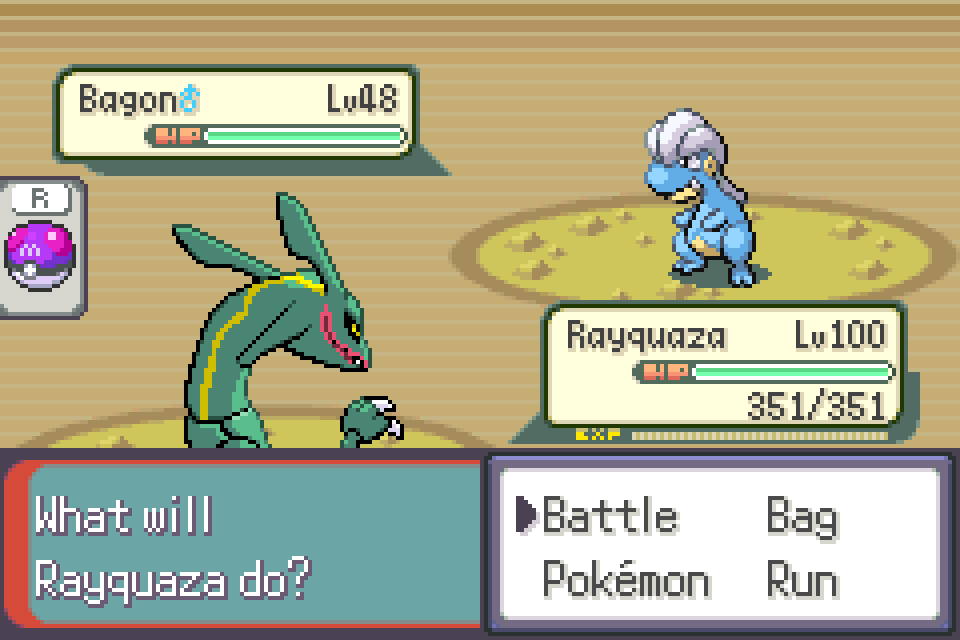
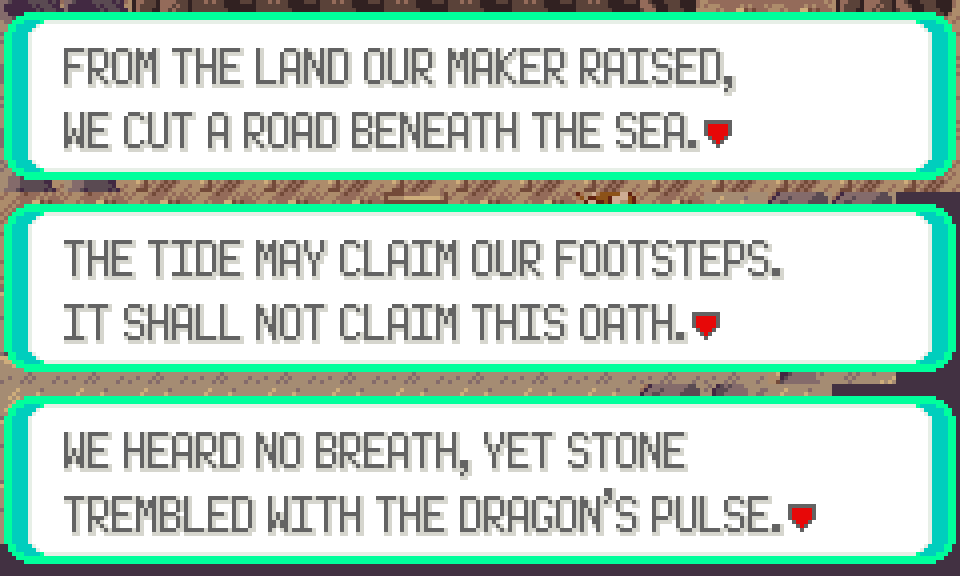

# Interior passages, cave encounters and sanctuary scale

Actual Pokémon Emerald: Legends v0.0.70 + unshipped Wyrmtide Debug review, mGBA 0.10.2. Game source ea8fef3e; public v0.0.75 unchanged. The owner approved f4e6cae2, then requested these refinements. New visuals await review; PR #89 remains draft.

## Passages

The upper openings reuse the complete Seafloor Cavern arch, caps and mouth shade over the accepted wider treads. Two free8px cells extend only the native arch's inner column, preserving each curved end once. The lower flights retain their final risers, disappear into native cave shade and use the standard south-arrow exit behavior. Both upper lanes work; every lower exit and the Heart return were walked in game. Warp coordinates/indices/aliases and all five layouts' collision/elevation words remain exact. Accepted terrace geometry, lighting, pool and island remain protected.

## Regidrago

A dedicated64×64 stationary object reuses the game's existing detailed Regidrago front art and native palette. Its normal32px follower graphics and all source Pokémon art remain unchanged. The anchor moved down one tile to clear the final inscription. New graphics/palette IDs live outside existing native/dynamic/player ranges; no enum values or serialized layouts moved. Battle, escape, defeat/rematch, capture, caught-object removal and native flash flags passed with the larger object.

## Encounters

Native encounter rate8 provides restrained encounters on the four descent floors. Ordinary slots contain Golbat, Graveler, Sableye, Mawile, Nosepass, Carbink and Onix. Dragons total5% of each table, split4%/1%; these are conditional encounter-table weights, not per-step probabilities. The Heart remains free of random encounters. All pre-existing encounter tables remain exact and new headers append.

| Chamber | Levels | Dragon4% | Dragon1% |
| --- | --- | --- | --- |
| First descent | 48–54 | Bagon | Gible |
| Tidal gallery | 50–56 | Noibat | Axew |
| Third descent | 53–59 | Druddigon | Deino |
| Final descent | 55–61 | Gabite | Fraxure |

Actual non-repelled walking triggered battles on every floor; their species/levels matched the compiled rosters and native cave battle environment. The Bagon image uses a controlled seed with production generation from the live4% slot. It does not represent an observed random sampling rate. Other story/movement fixtures use native Repel with a high-level lead so random battles cannot mask quest checks.

## Inscriptions

Every visible carving is now readable, with distinct Threshold, Tidal and Deep lore for previously decorative or repeated carvings. Existing first shore, first cave and final inscription text remained byte-exact under regression guards. Other already distinct island clues remain unchanged.

## Verification

[Bound QA/source/capture record](../../../qa/wyrmtide-interior-feedback.json), [project CI42131155521](https://github.com/BabyCRTTV/pokeemerald-emerald-legends/actions/runs/42131155521). Debug, unmodified title SELECT Quickstart and full native Wyrmtide call/voyage/gates/walking/doors/lore/retry/capture/flash/report/wild-encounter checks passed on ROM bf5e3670080379c2655d4c375a2e3cec336a2dc6caf29cc838b7c97d5b5000dc. Source/appearance/wardrobe checks passed. Every PNG is an actual compositor frame, exact nearest-neighbor scaling or documented crop/assembly of those frames. The gallery builder verifies source hashes and downscaled RGB equality.

Native reference: complete local vanilla Seafloor Cavern doorway assemblies, native south-arrow exits, accepted Wyrmtide treads/depth, and the [standing vanilla/Emerald Crest reference audit](../terrain-review/README.md). No Crest artwork was imported. No AI/stock gameplay image is used.

This is a controlled Debug review, not a natural full-story, historical owner-save, Release-emulator or Pizza Boy playthrough. Prior clean Release job42125621400 was cancelled during compiler installation; local LTO had an internal compiler crash. Release/BPS readiness remains unverified. Reconcile the older feature branch with current master and its save/art/workflow protections, then run current candidate and patch gates before publication.
