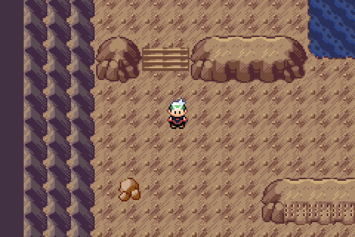
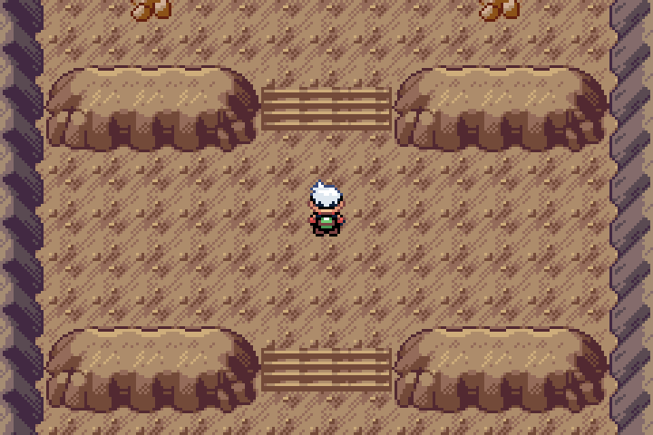
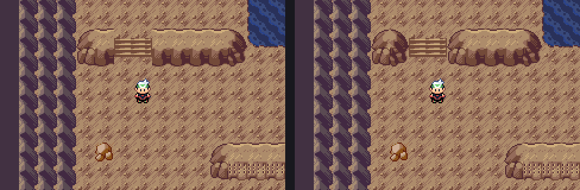

# Wyrmtide stair-bank fit review

Actual compiled Pokémon Emerald: Legends v0.0.70 + unshipped Wyrmtide Debug ROM in mGBA0.10.2. The public v0.0.75 release is unchanged.

The owner liked the stair treads and identified the remaining side gaps. The previous pass cut a rectangular flight through unclosed middle-face rock cells. The sides therefore ended abruptly against the floor strips.

This repair closes both neighboring banks using the original Cave end-cap assemblies: right-facing0x20A/0x21A on the left, left-facing0x208/0x218 on the right. Twenty-eight solid rock cells around seven flights change. The rounded rock shoulders now meet the stair cut with native side faces and feet.

The approved tread artwork and every stair cell remain exact. No shared or sibling pixel art, metatile definition, palette, collision/elevation bit, dimension, warp, script, persistent ID or saved-data structure changed. The water, island, visible cave entrance and approved Regidrago Heart are preserved. The native Heart capture remains RGB-identical.

The explicit helper `tools/legends/fit_wyrmtide_stair_banks.py --apply` validates all four current map hashes before any write. Source checks require the complete cap pair on each side, retained tread assemblies and existing physical topology. Preserve subsequent owner Porymap edits; do not regenerate these maps from historical helpers.

All preview enlargements use exact nearest-neighbor scaling. The original240×160 landing/close-view frames are in this folder. [Earlier tread review](../stair-review/README.md), [standing vanilla/Emerald Crest reference audit](../terrain-review/README.md), [bound verification receipt](../../../qa/wyrmtide-stair-fit.json).

## Verification

- Local Debug compilation, normal unmodified Quickstart and the full native Wyrmtide quest/stair/doorway/retry/capture suite passed. Water animation and approved-Heart RGB checks passed.
- The four exact source map binaries are present once each in the native-tested ROM; offsets and source hashes are in the receipt. Before/after frames prove the treads and landings are RGB-identical, with changes confined to the two bank-side strips.
- [Source CI42090761704](https://github.com/BabyCRTTV/pokeemerald-emerald-legends/actions/runs/42090761704) passed on source `437d194798508653a68f6e4ed2f03f7d18bcc334`.
- [Standard Release CI42090947236](https://github.com/BabyCRTTV/pokeemerald-emerald-legends/actions/runs/42090947236) passed at `2c60919dee6933a420155c26e183e1692c9aaa9e`, whose game files are unchanged from that source. It verifies default LTO and the same four map blob hashes.
- Debug ROM SHA256: `042d5eea96626eceabc736f267ae6ac8cbbeaa8d0ffd1ca12772cc7e5df61a1f`.
- Release ROM SHA256: `6c2c04b284c06af2174f8234ce2c9816dcca7aec01eb087d7906bdf9cf08a00f`.
- A local LTO compiler crash was superseded by that clean standard Release build; no successful local Release link is claimed.

This is visual review on the old v0.0.70 feature branch. Current-master reconciliation and current Release/Debug BPS gates remain before publication. Full native gameplay checks here use controlled Debug fixtures, not a historical owner save, natural full-story run, Release Wyrmtide playthrough or Pizza Boy test.
