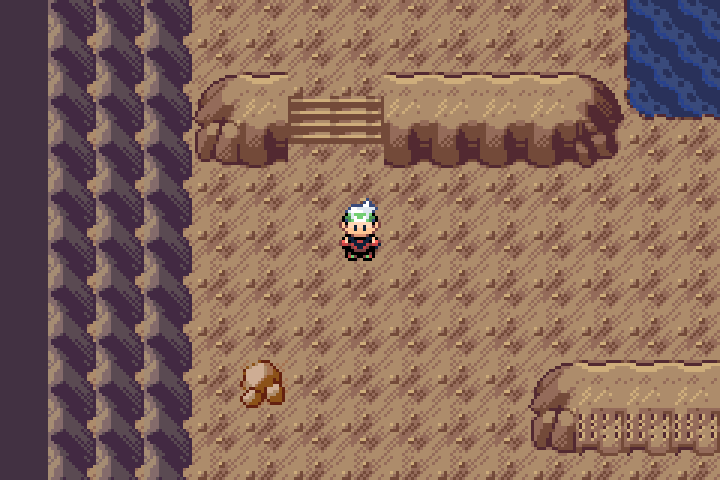
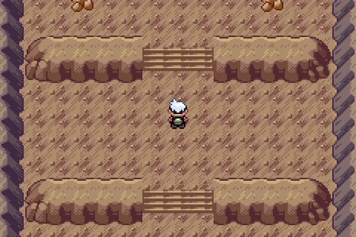
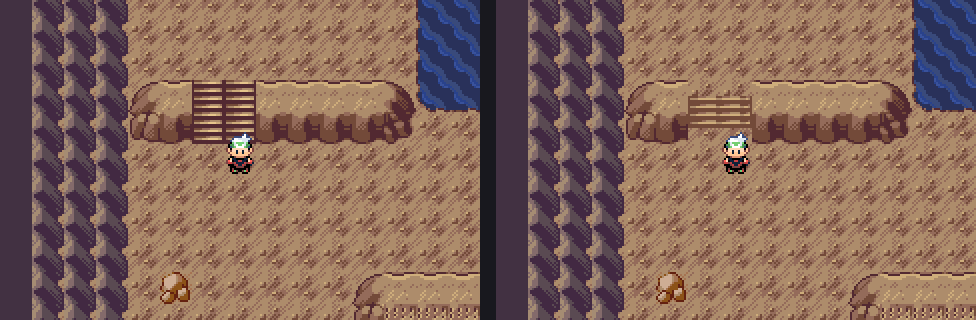

# Wyrmtide stone stair review

Actual compiled Pokémon Emerald: Legends v0.0.70 + unshipped Wyrmtide Debug ROM, captured with mGBA 0.10.2. Public v0.0.75 is unchanged.

All gameplay images are real emulator frames, scaled by exact nearest-neighbor sampling. Original 240×160 frames are included in this folder.

## What changed

The old stairs repeated a complete narrow Cave 0x204 flight sideways and vertically. This duplicated dark side edges and eight closely packed risers, creating a ladder-like appearance.

The new modules assemble the existing native Cave tread/edge pixels into one continuous flight. Only the outside edges remain; four risers meet eight-pixel Cave 0x201 floor landings above and below. Three native index substitutions (1→2, 2→3, 7→6) use the existing sandstone bank6 and soften the bright highlight/dark edge. No foreign or generated artwork is used. The wider final landing inserts an interior module rather than repeating a complete narrow stair.

Eight sibling-only metatiles 0x3B1–0x3B8 use previously unreferenced tiles976–1007. Every older tile and metatile retains its original indexed pixels/definitions. Ordinary steps preserve behavior0; single approach stairs preserve the existing bottom warp behavior0x61.

Only existing stair cells in Descent1–4 changed: 12/8/12/16 cells respectively. All collision and elevation bits, map sizes, warp endpoints, scripts, saved data, approved island/Heart and the improved animated pool are retained. The explicit authoring helper verifies all baseline Git blob hashes before writing and refuses later owner edits.

## Reference and verification

The geometry/material source is the repository's original Emerald Cave tiles0x204 and0x201. The standing [vanilla/Emerald Crest audit](../terrain-review/README.md) guides the complete terrain assembly; no Crest artwork was imported. The earlier water pass is documented [here](../water-review/README.md).

Compiled game source: `09452e99120eae4ea691dba3e32f248ea9a1f1e8`. [Native run42086012859](https://github.com/BabyCRTTV/pokeemerald-emerald-legends/actions/runs/42086012859) passed Debug/Release builds, the full Debug Wyrmtide quest/stair/doorway/battle/retry/capture suite, water animation and existing Debug/Release Continue checks. The approved Heart is RGB-identical to its earlier native capture. [Final source/asset checks42086328363](https://github.com/BabyCRTTV/pokeemerald-emerald-legends/actions/runs/42086328363) passed on the guard-only successor `4364c3fe`; no game/harness change followed the compiled source. Recovery42087907321 verified the complete artifact SHA256, all original PNG hashes and exact nearest-neighbor derivation.

Verification details, workflow/source pins and limits are bound in [the machine receipt](../../../qa/wyrmtide-stair-review.json). This is a visual review on an old feature branch, not a release. Current-master reconciliation and current Release/Debug patch gates remain necessary before publication. No historical-owner-save, natural full-story, Release Wyrmtide playthrough or Pizza Boy claim.
