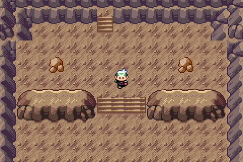
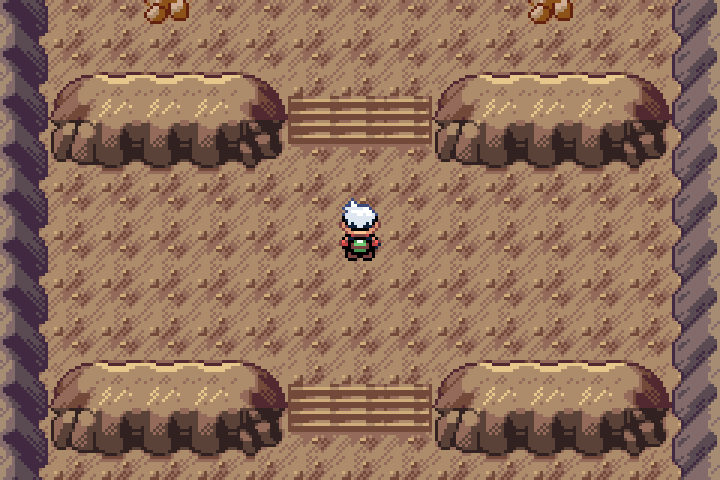
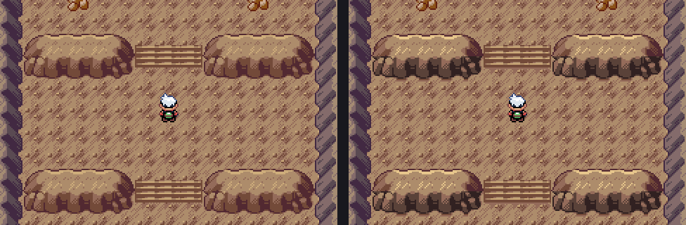

# Wyrmtide terrace depth review

Actual compiled Legends Debug v0.0.70 plus unshipped Wyrmtide, captured with mGBA0.10.2. Public v0.0.75 is unchanged.

The player starts on the upper landing and walks south down the first terrace toward Regidrago. This uses24 actual emulator frames sampled every4 emulated frames, with pauses at the ends. The GIF retains every original RGB color and uses exact2× nearest-neighbor enlargement.

## Depth cues and retained geometry

Existing upper-rim pixels receive a native warm highlight. The vertical rock faces use two deeper native stone shades. Native bank-foot silhouettes provide short contact shadows under the ledges; a single soft shadow row settles each final riser onto the lower floor.

All accepted tread pixels, bank silhouettes, fitted side joins and stair coordinates remain exact. The dominant floor colors remain consistent. Six contextual rim/face cells and two floor-shadow cells append to the sibling. Only4 unused8px tiles1008–1011 are added; no shared artwork changed.

Private banks7/8 were verified loaded and unused by old Wyrmtide/Heart references. Other slots, including water and day/night wiring, remain exact. Colors come from native Cave06 index2, Cave07 index7 and Mt Ember FRLG12 index12; existing native pixel masks supply the geometry and shadows.

All four layouts normalize exactly to the accepted layout words when contextual cells resolve to their sources. Collision/elevation bits, tile behaviors, warps, dimensions, scripts, persistent IDs and saved data are unchanged. Heart, island and water are protected. The native Heart is RGB-identical and pool animation passes.

## Verification

Source `ad731de350e49aeed830fde05e97cc594aa81e49` passed local Debug compilation, unmodified Quickstart and full native Wyrmtide walking/story/doorway/gates/retry/capture/flash/report checks. The fixture asserts actual southward movement past the first bank. [Source CI42096385738](https://github.com/BabyCRTTV/pokeemerald-emerald-legends/actions/runs/42096385738) and [standard Release CI42096385990](https://github.com/BabyCRTTV/pokeemerald-emerald-legends/actions/runs/42096385990) passed. All14 Release input files match the committed candidate under the repository's declared CRLF checkout rule for palettes; the receipt records canonical and checkout hashes.

- Debug ROM: `e705d98267de46954e91bdd85e981234c1d10569c15ef7b3113115cadf42fcad`.
- Release ROM: `bcc5ac46d383b190dfd627636eff1de5500ce76f9520215108d34783ca3591d9`.
- [Bound receipt](../../../qa/wyrmtide-terrace-depth.json): actual frame hashes, decoded-GIF color/scaling checks, source inputs and compiled-map offsets.
- `tools/legends/build_wyrmtide_depth_gallery.py`: reproduce the gallery from freshly verified native captures and check every decoded GIF frame.
- [Accepted fitted-bank baseline](../stair-fit/README.md), [vanilla/Emerald Crest audit](../terrain-review/README.md).

Stills use exact3× enlargement; original240×160 key frames are included. New lighting/shadows await review. This old feature branch requires current-master reconciliation and current Release/Debug BPS gates before publication. No historical-owner-save, natural full-story, Release Wyrmtide playthrough or Pizza Boy claim.
