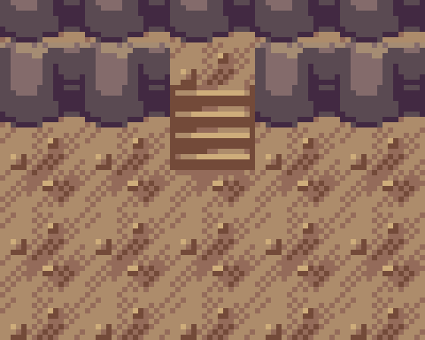
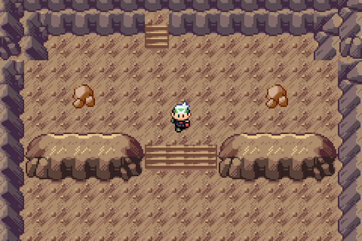

# Upper return staircase

Actual mGBA0.10.2 frame from Legends Debug v0.0.70 plus unshipped Wyrmtide. The close-up crops pixels64,0–144,64 and enlarges them6× with exact nearest-neighbor sampling. The full frame is enlarged3×. No artwork, map or fixture was edited.

This is the upper return stair of the fourth descent landing. Walking north onto its warp at8,3 loads the previous landing, arriving at Descent3's lower exit11,20. Entering this room from that previous landing places the player here; walking south continues through the descent. The broader flights change terraces inside the room, while this narrow stair connects the rooms.

The source frame and all four stair return pairs are covered by the existing full native proof. [Crop/source receipt](../../../qa/wyrmtide-upper-stair-inspection.json). The approved terrain/depth baseline remains intact.
