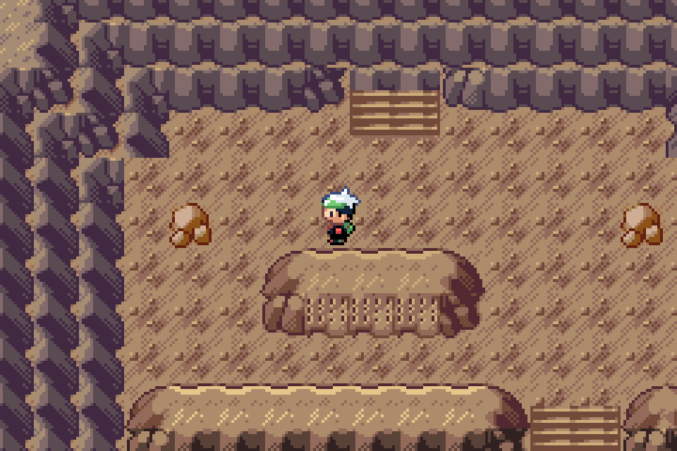
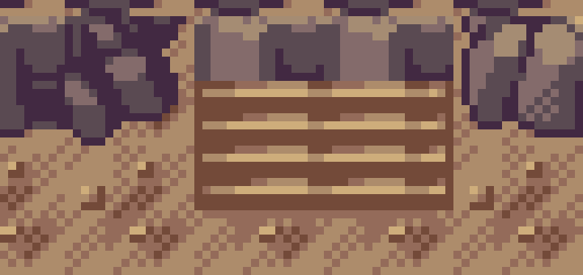

# Upper return stairwell and continuous cavern tour

Actual Pokémon Emerald: Legends v0.0.70 + unshipped Wyrmtide Debug review, mGBA0.10.2. Source checkpoint55b4268f; publicv0.0.75 unchanged. The wider upper return opening uses accepted native treads with Sealed Chamber canopy and complete native rock caps. Both columns8/9 are live. Original warp indices0/1 remain; alias2 returns to the same destination as0. Only adjacent cell(9,2) becomes walkable in each room. Approved terrace flights/depth, pool, island and Heart remain protected.

[Full continuous 2:06 walkthrough with native audio](https://chatgpt.com/library?file_id=libfile_17a61f47ee68819187e58bf0c91787cd&account_id=personal): cave entrance → first descent and inscription → tidal gallery → third descent and inscription → fourth descent → Heart inscription → sleeping Regidrago. The movie ends before battle. It starts after a controlled open-seal setup; no scene resets, teleports, party edits or flag changes occur while recording. Actual game movement/warps and status-only private fixture queries continue throughout. The distributed video contains no ROM/private payload.

| Time | Location |
| --- | --- |
| 0:00 | Cave entrance |
| 0:06 | First chamber and upper stairwell |
| 0:25 | First depth inscription |
| 0:39 | Tidal gallery |
| 1:00 | Third chamber |
| 1:29 | Fourth chamber |
| 1:43 | Regidrago sanctuary |
| 1:50 | Final inscription |
| 2:06 | Sleeping Regidrago |

[Native walking/story/build receipt](../../../qa/wyrmtide-upper-stairwell.json), [movie/audio provenance](../../../qa/wyrmtide-walkthrough.json). The source is240×160 at actual GBA timing; the compatible MP4 uses nearest-neighbor4x scaling, H.264 CRF15 and native AAC audio. Chapter PNGs retain exact native RGB at3x. A silent draft was rejected; the final verified audio has a real nonzero waveform. Controlled Debug fixtures do not represent a historical owner save or natural full-story/Release-emulator test. Keep PR#89 draft; no merge/publication instruction.
