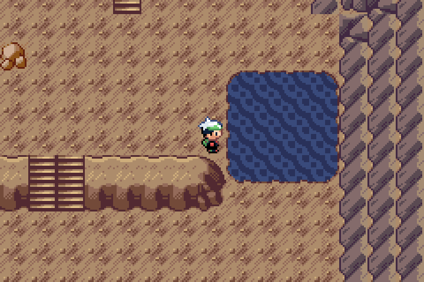
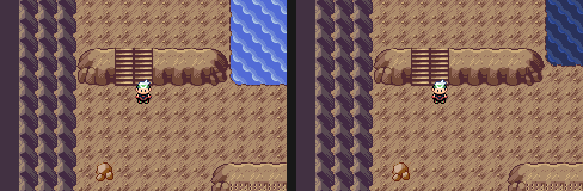

# Wyrmtide interior water review

Actual compiled Pokémon Emerald: Legends v0.0.70 + unshipped Wyrmtide Debug ROM, captured with mGBA 0.10.2. The public v0.0.75 release is unchanged.

The remaining Descent2 pool now uses darker, quieter native blues, a 4×4 footprint and a complete native pond rim joined to the rock ledge. Nine appended metatiles reuse the original animated water tiles and contextual Cave-floor/rock edges. Four distinct colors are taken from vanilla General/Cave palettes, with no new pixel artwork. Reference composition follows the standing vanilla Emerald/Emerald Crest audit in [the terrain review](../terrain-review/README.md); no Crest artwork was imported.

The comparison uses the same native camera fixture before and after. The close view above shows the entire pool. Both images use exact nearest-neighbor scaling. Original 240×160 frames: [landing](05-second-landing.png), [pool](26-tidal-pool.png), [next animation frame](27-tidal-pool-animation.png).

## Scope and verification

Only Descent2's map and the private Wyrmtide sibling definitions/palette were refined. Other maps, approved Heart/shore/entrance, shared pixels, native water animation, scripts, persistent IDs, warp endpoints and serialized layouts remain intact. The approved Heart screenshot is RGB-identical to its earlier capture.

Private bank11 is loaded by the field engine and unused by previous Wyrmtide map cells. Native day/night slots5/12 remain exact. Bank13 was an intermediate error caught by native inspection and is not part of this candidate. Source tests guard the loaded range, original palette wiring, distinct RGB555 colors and exact native water/rim geometry. The authoring helper rejects changed baseline Git hashes.

- Compiled game source: `733d93908d203f2ded6b8d182c98269232349472`.
- [Native workflow42077224680](https://github.com/BabyCRTTV/pokeemerald-emerald-legends/actions/runs/42077224680): Debug and Release builds, full Debug Wyrmtide gameplay suite, water animation pixel-change check, existing Debug/Release Continue suites passed.
- [Project workflow42077581017](https://github.com/BabyCRTTV/pokeemerald-emerald-legends/actions/runs/42077581017): final palette/source guards and existing project checks passed.
- [Machine receipt](../../../qa/wyrmtide-water-review.json) binds source, ROM SHA256, PNG SHA256 and the verified native artifact archive digest.
- Read-only recovery run42077310814 verified that archive digest and each recovered PNG before review. Temporary recovery/branch workflow changes were removed.

These controlled fixtures exercise the real map/script/battle engine. They do not establish an authentic historical owner save, natural full-story run, Release Wyrmtide playthrough, Pizza Boy behavior or independently applied Release/Debug BPS readiness. This old feature branch still needs reconciliation with current master. The water is awaiting visual approval; this review does not publish a release.
