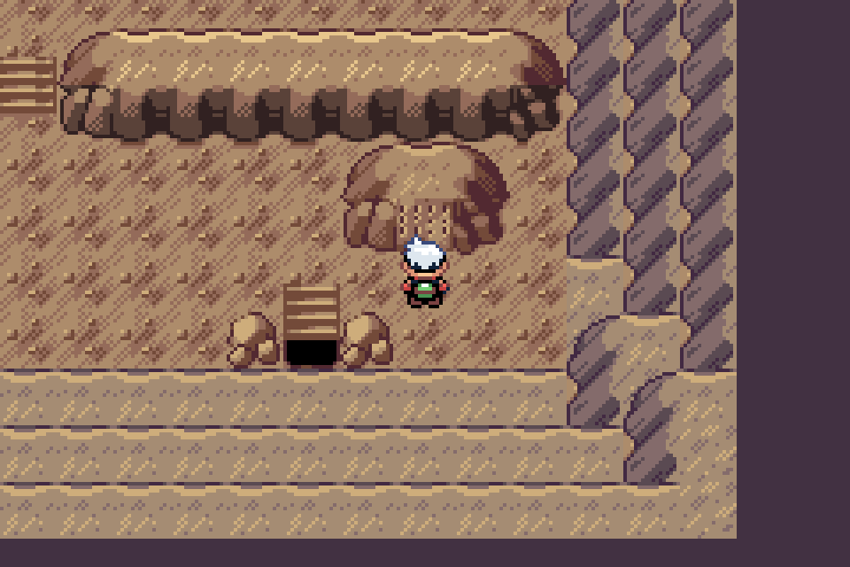
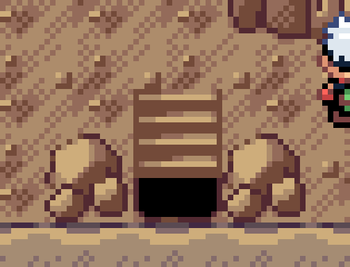
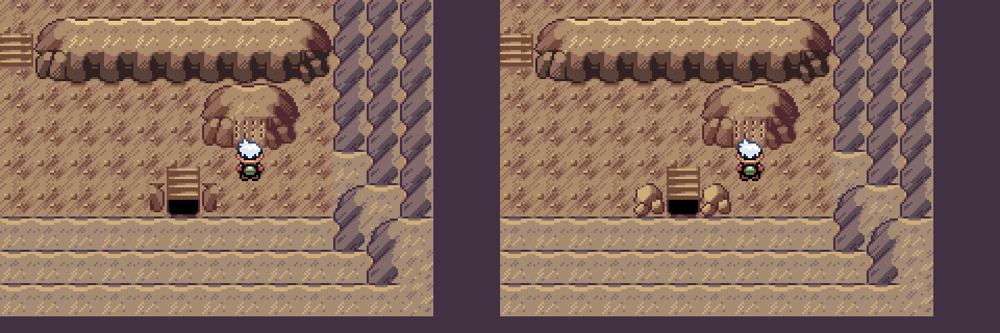

# Complete lower-exit rocks

The previous compact side pieces cropped native wall end-caps into half-rocks. The owner identified their cut outlines. Both contextual definitions now copy the complete native Cave0x202 rock, all eight metatile words, with its full rounded top, sides and base. No quadrant is cropped or mirrored. Native pixels/palettes, stair/recess, every layout/collision/elevation word, warp, script, encounter and Regidrago remain unchanged.

Before, left; after, right:

Debug, focused source guards and full native mGBA walking/exit/return/quest/party gate/retry/capture/flash/report/wild-encounter tests passed. The whole-frame difference is restricted to the two rock positions. Upper-mouth and larger-Regidrago frames remain RGB exact. The authoring helper reproduced source byte-exact and refused changed owner inputs before writing. AGENTS now explicitly requires whole silhouettes/bases for freestanding rocks and disallows cropped wall caps as standalone rocks.

[Bound source/native receipt](../../../qa/wyrmtide-whole-exit-rocks.json). Actual mGBA0.10.2, v0.0.70 plus unshipped Wyrmtide Debug. Nearest-neighbor4x context,8x exact detail crop,3x matched comparison. This remaining exit detail awaits review; other owner approvals carry forward. Keep PR89 draft/publicv0.0.75 unchanged. Prior Release/LTO/compiler-setup limits and current-master/release/BPS reconciliation remain outstanding before shipping.
