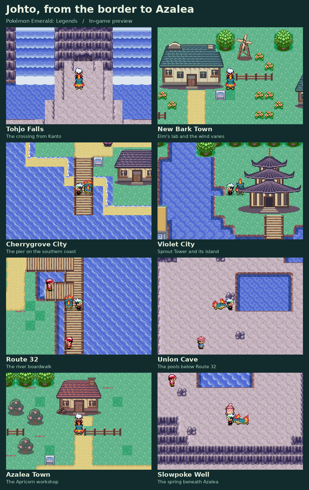

# The first two Johto badges

From Viridian, head west on Route 22. The Indigo gate opens onto Route 26. Follow Route 27 through the dry shelf at Tohjo Falls to New Bark Town. Players can walk back across the same border at any time.

| Place | What to find |
| --- | --- |
| New Bark Town | An older Professor Elm offers a field survey at his wind lab. |
| Cherrygrove City | Read the tide post next to the pier. Routes 30 and 31 lead north toward Violet. |
| Violet City | Speak to the keeper in Sprout Tower for Elm’s other observation. The central pillar continues into the belfry. Bird keeper Wren awards the Zephyr Badge. |
| Route 32 and Union Cave | The river boardwalk leads past local fishers. The Pokémon Center stands near the north entrance to Union Cave. Leave the cave to the south and head west on Route 33. |
| Azalea Town | Visit the Apricorn workshop and descend the covered entrance to Slowpoke Well. Rue accepts challengers who hold Wren’s badge and awards the Hive Badge. |

The Zephyr and Hive badges appear in the **Johto League** journal entry. Five local trainers also accept optional battles. The Johto PokéNav sheet supports Fly to all four visited towns.

The Heart & Soul team provided a visual reference for eastern Johto in Gen III. The layouts, landmark art, trainer teams and story here were made for Emerald: Legends. [Heart & Soul project and credits](https://github.com/PokemonHnS-Development/pokehns-expansion/tree/167aa6d)

## Verification on November 25, 2026

- Walked the full trip from Viridian to Azalea and back in mGBA 0.10.5, including all 32 directional transitions. Drove the doors of all 19 town and route buildings or caves in both directions, plus the stairs between the two Sprout Tower floors.
- Completed Elm’s survey in both orders and reloaded battery saves between readings and after returning to the lab.
- Tested Rue’s entry requirement, defeated both leaders in native battles, reloaded the victory flags and revisited them. Won all five optional battles, checked their independent flags and encountered a wild Pokémon in the Route 32 grass.
- Used all four Pokémon Center nurses to restore a damaged party, checked local respawn destinations and used Fly to all four towns.
- Imported a 128 KiB battery save created by v0.0.94. The new build retained the party Treecko, boxed Treecko, held Flame Plate, 103 Potions, hairstyle, autumn season and Birch story flag. Johto’s survey and badges began unset.
- Applied the Release and development BPS patches to clean US Emerald with both Floating IPS and the project’s browser patcher code. Each result matched its compiled ROM byte for byte. Booted the reapplied Release ROM in mGBA, chose Continue, battled Wren, earned the Zephyr Badge and returned to the Gym using ordinary controller input.
- Ran 21 focused project regression suites covering the new chapter, Kanto, the Adventure Log, storage, wardrobe, trainer card, grottos, seasons, plate monks and the selected expansion fixes. The two host sanitizer tests ran with leak discovery disabled because this runner traces processes. Their address and bounds checks ran.

The preview film contains native game footage and sound. Scene starts use a staged party and location, with cuts for travel and battles. The uninterrupted walking check and the unmodified Release test were separate runs. Existing map and quest IDs and the native saved trainer range retain their positions. The chapter appends 36 maps and two journal entries and assigns independent flags for its new trainers.

| Artifact | SHA |
| --- | --- |
| Clean US Emerald, SHA-1 | `f3ae088181bf583e55daf962a92bb46f4f1d07b7` |
| Johto Release BPS, SHA-256 | `718fea7651bcb58d06cc7cea8818abf462292e0ba1152767cab3aa5090d0b56a` |
| Reapplied Release ROM, SHA-256 | `e148031218e29b344a07eee5b9b87d3776e977b489e2a9b0dca661ff3f1c76f3` |
| Gameplay film, SHA-256 | `c30f26aacbde6e780f9a9183afaac0329f6b7facfb6fe6ad7a11bfb0b4887743` |

Built with Codex (GPT-6). The draft builds on the Chosen One candidate at `8f2a5e5`. The public release during this preview is v0.0.94.
