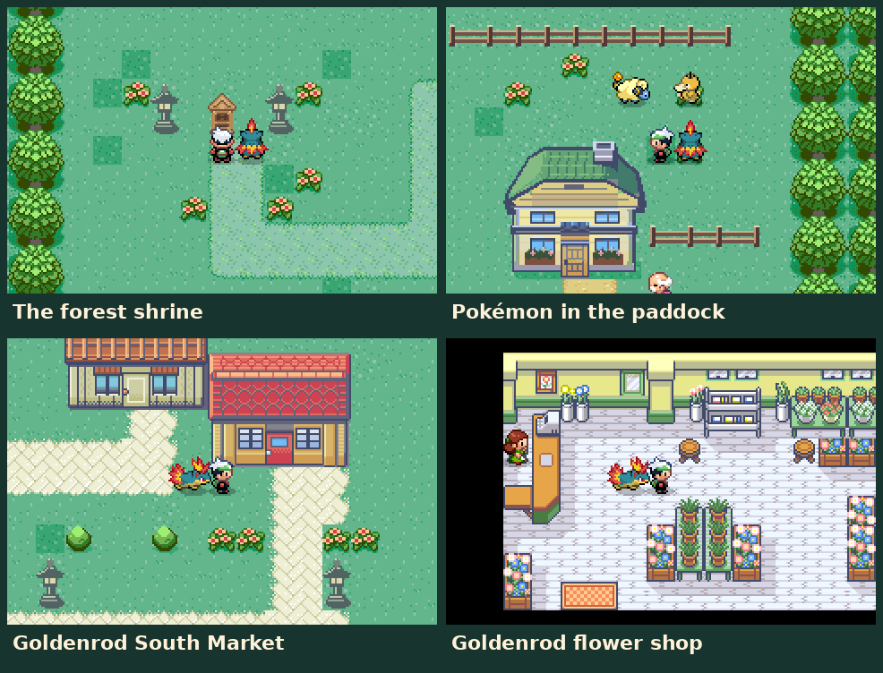
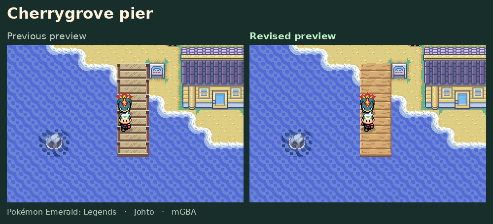
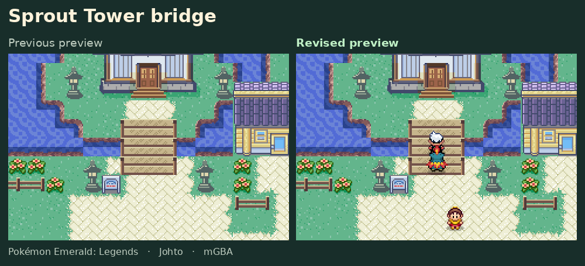
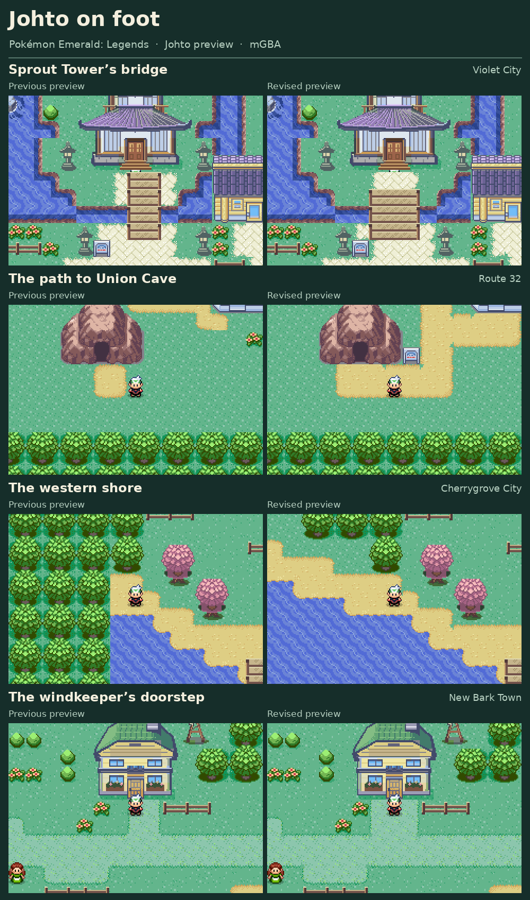
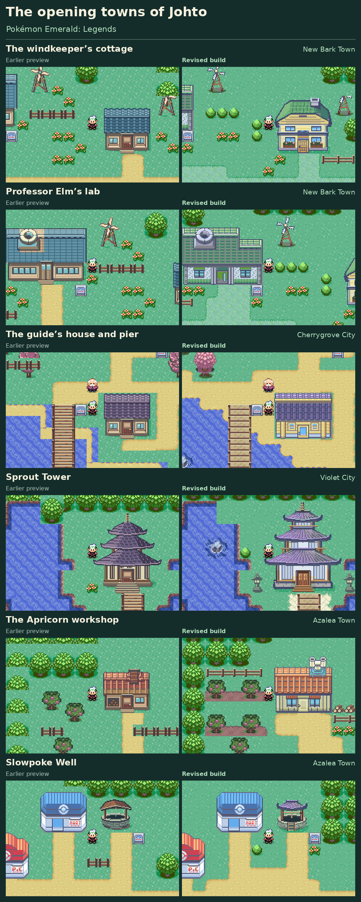
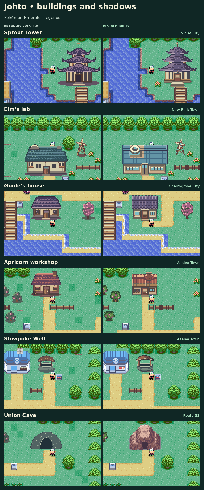
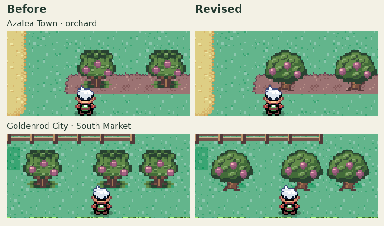

# The first two Johto badges

From Viridian, head west on Route 22. The Indigo gate opens onto Route 26. Follow Route 27 through the dry shelf at Tohjo Falls to New Bark Town. Players can walk back across the same border at any time.

| Place | What to find |
| --- | --- |
| New Bark Town | An older Professor Elm offers a field survey at his wind lab. |
| Cherrygrove City | Read the tide post next to the pier. Routes 30 and 31 lead north toward Violet. |
| Violet City | Speak to the keeper in Sprout Tower for Elm’s other observation. The central pillar continues into the belfry. Bird keeper Wren awards the Zephyr Badge. |
| Route 32 and Union Cave | The river boardwalk leads past local fishers. The Pokémon Center stands near the north entrance to Union Cave. Leave the cave to the south and head west on Route 33. |
| Azalea Town | Visit the Apricorn workshop and descend the covered entrance to Slowpoke Well. Rue accepts challengers who hold Wren’s badge and awards the Hive Badge. |

The Zephyr and Hive badges appear in the **Johto League** journal entry. Five local trainers also accept optional battles. The Johto PokéNav sheet supports Fly to all four visited towns.

The Heart & Soul team provided a visual reference for eastern Johto in Gen III. The layouts, landmark art, trainer teams and story here were made for Emerald: Legends. [Heart & Soul project and credits](https://github.com/PokemonHnS-Development/pokehns-expansion/tree/167aa6d)

## West from Azalea to Goldenrod

Azalea’s west road opens into Ilex Forest. The woodland boardwalk leads north to Route 34 and its Day Care, then into Goldenrod’s South Market. The shrine occupies a side clearing. Its Miracle Seed is available once and can be claimed later if the Bag is full. The new streets contain a Pokémon Center, florist, herbalist and bicycle exchange. The Goldenrod Gym and northern districts are future work.

- Added eight maps after the original 36, and appended the new map sections, heal location and two flags. All earlier map and save IDs keep their positions. The Goldenrod PokéNav marker and Fly arrival use the Pokémon Center doorstep.
- Walked the entire route from Azalea and back in mGBA. Checked all seven outbound road lanes and walked through all five exterior doors in both directions. Encountered Hoothoot in Ilex Forest and Rattata on Route 34. The Goldenrod nurse restored HP and Fly landed outside the Center.
- Collected the Miracle Seed, revisited the shrine and saved and reloaded with exactly one seed. Verified the shared Day Care with a seeded Mareep and Psyduck. Both appeared in the paddock, could be withdrawn for 100 each, and the empty paddock and party persisted on reload. Purchased Energy Powder at the herbalist, opened the decoration catalog at the florist, and exchanged Mach and Acro Bikes in both directions.
- Saved on the previous timber preview in Azalea at (2, 17), recording the original west tree line in the battery save. Continued on the reapplied Release and walked into Ilex Forest and back. Only Azalea uses the new scenery-cache marker.
- The Johto and region-map regressions passed. Floating IPS and the browser patch decoder independently reconstructed both native builds from clean US Emerald. The tour uses native game frames and sound. Scene starts are staged, including the two Pokémon shown in the paddock.

| Artifact | SHA-256 |
| --- | --- |
| Release BPS | `5ae8ef8bcb1721143de9ddea54d862db0aea594b9195938906e28a50ff6447ea` |
| Release ROM | `9bb67a042a596160c933f7dc663bb196418ef0c643dbf7ec9b5bfcdc07fb4cd3` |
| Debug BPS | `8234cae04d0a6d3473da538474b8696e2e0faba8e7b63525364629a65c1d7b1c` |
| Debug ROM | `bff690471cc0011fa4ae0983ccbc601cd36af48d3488080cc3acd88f06a5c0eb` |

## Timber shading on Johto crossings

The Cherrygrove pier, the bridge to Sprout Tower and the Route 32 boardwalk use a narrow highlight on the sunlit edge of each plank. Short, offset grain marks and a darker exposed end follow the scale of Dewford’s pier. The seven deck metatiles use the existing outdoor timber palette.

Walked all three crossings in mGBA with matched controller input and inspected each at noon and at night. All 84 movement checks passed. Surf mounted and dismounted at the pier. Verified the other metatiles’ graphics, sprite layers and palettes against the previous preview. Floating IPS and the browser decoder both reproduced the native Release and Debug ROMs. An older battery save resumed in the reapplied Release and passed the lab entrance and exit.

| Artifact | SHA-256 |
| --- | --- |
| Release BPS | `fe2a0b424d9d1a8fcfb4a2a0f738bbdaa4b96a2e8f1ca3cea2b285b8545ae613` |
| Release ROM | `2f685080266d0c19d5eb024e3108eae8e81cefd221517ea7c349d9a92258f3ec` |
| Debug BPS | `d28cb28e473eb3b7c1186b78ef1267d146182f24326855b5958ef9cbbacfea2f` |
| Debug ROM | `2e5d99839cbb716cff8ac68b13ffb9ac1c4129e7c9e7200daa7ab5c4d5d86459` |

## Trainer visibility on Johto terrain

Opaque wooden planks and paving were drawing in front of the trainer. Changed the layer attributes for walking surfaces, the bottom edges of local scenery and indoor props. The graphics, collision, map coordinates and save data retain the approved preview values.

- Used matched mGBA captures and a 214-pixel standing trainer reference. All 214 pixels appeared in 23 ground and frontage samples. At Cherrygrove pier, Sprout Tower bridge, Violet’s paving and the Route 32 boardwalk, the previous build showed zero reference pixels. A separate walk-behind sample at Elm’s roof showed the same 54 visible pixels in each build.
- Replayed the same controller steps in both builds on four stretches. The comparison runs 12.6 seconds. Checked 84 movements at road joins, bridge boards, shorelines and other collision boundaries. All 19 exterior entrances and returns, the belfry stairs, four nurses and four Fly arrivals passed.
- Built Debug and Release. Floating IPS and the browser patch decoder independently reproduced both ROMs from clean US Emerald. Loaded an older battery save on the reapplied Release, checked the wall beside Elm’s lab and walked through its door in both directions.

| Artifact | SHA-256 |
| --- | --- |
| Release BPS | `5d8662d5ff38c5edd4648c8cf727138c9c2345b9705a33abd8abed19cab39c43` |
| Release ROM | `5e2c50ff5b910033bd9af8137e38131dce6821e5540479189641235c4f3c2d85` |
| Debug BPS | `98ea223d2b4b5d1604c6ffcac863643c7fcf25378beb72807f3434a6695666fe` |
| Debug ROM | `c868ffa04ce8b87b06f3e99a02bb1289180e84397517e81b0caa364471ed3689` |

## Paths, entrances and map borders

The owner approved the town artwork in `bc2f6638`. This pass centered the cottage and civic doorsteps, the three-board bridge to Sprout Tower and the narrower entrance to Slowpoke Well. Route 32 has a continuous path from its Pokémon Center to Union Cave and a readable sign beside the cave mouth. Five coastal layouts have authored map borders that carry the shore out to sea. The beach corners share Slateport’s Surf elevation.

- Walked Viridian to Azalea and back through all 32 transitions. Tested all 19 field entrances and returns, the belfry stairs, all four nurses and all four Fly destinations. Exercised all 20 marked lanes in both directions at the nine outdoor connections.
- Ran 84 controller movement checks covering those lanes, all three bridge boards, the lantern and lab roof collision, the sign and the inside beach curves. Read the cave sign from the approach and checked its former spot on the roof. Separately tested 148 building and pier contacts and 37 garden, lantern and shoreline contacts. Surf mounted and dismounted normally at Cherrygrove’s pier. The west and south limits stopped the surfer in open water.
- Loaded a 128 KiB battery save from the approved town preview on the independently reapplied Release. Its 210-cell scenery cache carried marker `4A01`. Continue moved the player one tile south of the new cave sign. The post stopped movement and the player could walk east along the path. Separate older saves retained their positions at Elm’s lab and in Cherrygrove’s water. The current cache marker is `4A02`.
- All 288 previously defined Johto exterior metatiles and all 486 referenced secondary art tiles retain their bytes. Both existing Emerald and FireRed layout definitions produced identical headers, tables and constants under the old and new map compiler. Five invalid scenic-border definitions were rejected. The Johto, Kanto foundation, region-map and shared lighting checks passed.
- Built Debug and Release natively. Floating IPS and the project’s browser decoder independently reproduced both game images from clean US Emerald. The matched pictures and the 22-second walking clip came from the revised build running in mGBA 0.10.5. Scene starts used fixed locations and a summer daytime clock. Movement, the tower door and the Route 32 text came from controller input.

| Reviewed artifact | SHA-256 |
| --- | --- |
| Release BPS | `3cbd92decda67c1da018ad462d48967dcc38c05fa337d9a27e1b280eb8cc19c8` |
| Release ROM | `6edb60d8ca440ca6ac6c415eb03efeddeab2e1ee858ee7fb55d0d85c2e93e023` |
| Debug BPS | `472ef54c26aa30d8522c137c2c8d89809a3937b122a23ac84757f572570d91db` |
| Debug ROM | `4bce6696ad391ecdf0f0983a3bb9b6f1c956e0e936000bffb7648effac893adc` |
| Gameplay comparison image | `9ea62439da8af1319342fa53ed1ab5a9234e19c0e13bf818e53047f855776c55` |
| Gameplay clip | `9a2b4a8e6b2df79d146b0dcccf4e8ebd91567d53201d6b6da3772692909c66bb` |

## Towns, shorelines and woods

Six pairs show the same player positions in the previous draft (`eb4b6e7`) and the revised game. The accompanying 55-second film includes the walk from the windkeeper’s cottage to Elm’s lab, the waterfront, the crossing to Sprout Tower, the orchard and the descent into Slowpoke Well. The scenes start from staged locations. Movement, door animations, water, music and effects are captured in mGBA. The owner’s Heart & Soul references informed the house proportions and doorstep planting.

| Place | Map and artwork |
| --- | --- |
| New Bark | A handmade gabled cottage has an off-center chimney, window boxes and a green roof. Elm’s lab takes its vent and windows from Birch’s lab, with a recessed service wing. Shrubs flank the mown lane. |
| Cherrygrove | The guide’s house opens onto sand above a curved, south-facing shoreline. The pier uses Route 104’s plank pattern. The blossom trees use the native Emerald canopy, with a separate trunk. |
| Violet | Three tiled roofs shelter plaster and timber storeys at Sprout Tower. Stone lanterns mark the island and its approach. The street uses Rustboro’s diagonal paving. |
| Azalea | The workshop uses the Fallarbor furnace roof. Planting beds and logs mark the orchard. A stone drum, hand crank and ladder mark the entrance to Slowpoke Well. |
| Connecting routes | Emerald’s joined canopy and trunk tiles finish all twelve Johto outdoor layouts. The southern shore changes continue through both Route 27 approaches. |

The four Johto interiors with custom graphics now have their own tileset. Their map block numbers stay in place. Matched capture frames of both Sprout Tower floors and both Gyms were pixel-identical to the previous draft.

- Walked from Viridian to Azalea and back across all 32 directional transitions. Entered and exited all 19 buildings and caves, took the belfry stairs both ways, healed at all four Centers and used Fly to all four towns. Completed Elm’s readings in both orders, earned both badges in battle and reloaded each victory.
- Tested 148 building, eave, tree and pier contacts with directional input, plus 37 approaches to the lanterns, orchard rows, lumber stacks, cherry tree and south-facing beaches. Also entered and left Elm’s lab after dark.
- Checked the Johto map graph and graphics banks, north-to-south shore orientation, complete tree pairs, Kanto foundation, regional map and the shared night lighting.
- Continued a 128 KiB save from the immediately preceding Johto preview on the patched Release. With ordinary controller input the adjacent wall stopped the player, the lab door opened and the exit returned to New Bark. A second battery save from the former clearing at (6, 3) resumed at the nearest connected ground, (6, 5), and walked east. A third save preserved the player’s open-water position in Cherrygrove. Older Johto exterior saves discard their cached scenery. Newly saved views carry a revision marker in the unused tail of the existing buffer.
- Applied both BPS patches to clean US Emerald with Floating IPS and the project’s browser decoder. The reconstructed ROMs matched their respective compiled builds byte for byte.

| Artifact | SHA-256 |
| --- | --- |
| Release BPS | `66d2291c6e612fb64a2a3f03d85a1dce2c68fdc539ad588aec12350b81892fe7` |
| Release ROM | `2007e6674a4d469ec83bddeafad0e1496202497aa5f47f2aa304ca7cf0089222` |
| Development BPS | `d265d3af57cae413d6997d26b2057f025d2321f7b4ee78784897f69cdd0028ae` |
| Development ROM | `fb1361c57d8b1060e8dc74f77e37f3bc172ec52cc2630326cdf0dfab1f9c4ddb` |
| Comparison film | `6c0d371a53bf01b00c09c67d4bb6bf8c8d5da462a46c2f745007260b9e938e1b` |

## Revised buildings and collision

New Bark’s lab has a sliding entrance and observation windows. Cherrygrove’s waterfront cottages have timber porches and footpaths to their doors. Sprout Tower stands on a stone plinth with three tiled roofs. In Azalea, a chimney and firewood mark the Apricorn workshop, and two posts support the canopy over Slowpoke Well. Short shadows follow the foundations, tree trunks and wind vane feet. The four entrances to Tohjo Falls and Union Cave use rock outcrops from Emerald’s primary tiles.

Each pair shows the same camera position and summer daylight in mGBA. The 44-second comparison film also shows walking behind Elm’s roof, testing the lab wall, turning the corner under Sprout Tower’s eave, entering the workshop, descending into the well, and visiting the Cherrygrove storefronts at night. The edited film stages the start of each scene.

### Verification of the revised preview

- In mGBA, checked 150 individual movements around walls, rear and side eaves, tree and wind vane bases, cave faces, bridges and piers. The player stopped at 122 solid approaches and walked through the other 28. At Cherrygrove’s pier, the water stopped the player before Surf unlocked. With Surf unlocked, the same approach mounted and dismounted normally.
- Walked all 32 map transitions from Viridian to Azalea and back. Entered and exited all 19 buildings and field facilities, including Slowpoke Well, and climbed Sprout Tower’s stairs in both directions. Tested each of the four local nurses and Fly arrivals. Completed and reloaded Elm’s survey in both possible orders.
- Started the patched Release from its normal Continue menu with a battery save made by the previous Johto preview. Ordinary controller input stopped the player against the lab wall, opened the adjacent sliding door, entered Elm’s lab and returned outside.
- Checked Cherrygrove at noon and 10 p.m. The Mart and Pokémon Center lettering lit up while their surrounding walls dimmed. The same nighttime build passed the wall, entrance and return at Elm’s lab. The project’s nighttime lighting, Kanto foundation and region-map checks also passed.
- Built the development and Release ROMs. Floating IPS and the browser patcher’s decoder independently reproduced both compiled targets from clean US Emerald. The Johto map and event regression now includes building walls, walkable roof edges, native door behavior, Mart roof corners and tile space reserved for door animations.

| Revised artifact | SHA-256 |
| --- | --- |
| Release BPS | `8a544081acfd8770a835fd467c8643ba2ae0f1d89f51ada49947c35f990dc7f1` |
| Reapplied Release ROM | `3b80f40b49a47c9630a1d1977cfcc98e0f87883a9f974f554e56b9479c232968` |
| Development BPS | `0efba6590e9e98820479238825ec6360935a1f5d6a0ed08f5f7a067d5b43cced` |
| Reapplied development ROM | `8dc15c139105e6d6b5732acee00bdebd4948d47f9366230ae6e7ec55aca895d2` |
| Comparison film | `da2db170561eb0fd1140338c4c45e1831b7f3b160385dfb66cfe811eaa94168b` |

## Initial chapter verification on November 25, 2026

- Walked the full trip from Viridian to Azalea and back in mGBA 0.10.5, including all 32 directional transitions. Drove the doors of all 19 town and route buildings or caves in both directions, plus the stairs between the two Sprout Tower floors.
- Completed Elm’s survey in both orders and reloaded battery saves between readings and after returning to the lab.
- Tested Rue’s entry requirement, defeated both leaders in native battles, reloaded the victory flags and revisited them. Won all five optional battles, checked their independent flags and encountered a wild Pokémon in the Route 32 grass.
- Used all four Pokémon Center nurses to restore a damaged party, checked local respawn destinations and used Fly to all four towns.
- Imported a 128 KiB battery save created by v0.0.94. The new build retained the party Treecko, boxed Treecko, held Flame Plate, 103 Potions, hairstyle, autumn season and Birch story flag. Johto’s survey and badges began unset.
- Applied the Release and development BPS patches to clean US Emerald with both Floating IPS and the project’s browser patcher code. Each result matched its compiled ROM byte for byte. Booted the reapplied Release ROM in mGBA, chose Continue, battled Wren, earned the Zephyr Badge and returned to the Gym using ordinary controller input.
- Ran 21 focused project regression suites covering the new chapter, Kanto, the Adventure Log, storage, wardrobe, trainer card, grottos, seasons, plate monks and the selected expansion fixes. The two host sanitizer tests ran with leak discovery disabled because this runner traces processes. Their address and bounds checks ran.

The preview film contains native game footage and sound. Scene starts use a staged party and location, with cuts for travel and battles. The uninterrupted walking check and the unmodified Release test were separate runs. Existing map and quest IDs and the native saved trainer range retain their positions. The chapter appends 36 maps and two journal entries and assigns independent flags for its new trainers.

| Artifact | SHA |
| --- | --- |
| Clean US Emerald, SHA-1 | `f3ae088181bf583e55daf962a92bb46f4f1d07b7` |
| Johto Release BPS, SHA-256 | `718fea7651bcb58d06cc7cea8818abf462292e0ba1152767cab3aa5090d0b56a` |
| Reapplied Release ROM, SHA-256 | `e148031218e29b344a07eee5b9b87d3776e977b489e2a9b0dca661ff3f1c76f3` |
| Gameplay film, SHA-256 | `c30f26aacbde6e780f9a9183afaac0329f6b7facfb6fe6ad7a11bfb0b4887743` |

Built with Codex (GPT-6). The draft builds on the Chosen One candidate at `8f2a5e5`. The public release during this preview is v0.0.94.

## Johto Apricorn trees

The same sixteen 8×8 foreground cells supply all 24 trees in Azalea, Goldenrod and Routes 29, 30 and 33. Both grass and cultivated soil use the redrawn canopy and trunk. Source checks confirmed that only the six Apricorn metatiles reference the edited cells. The palette, metatile definitions and terrain attributes match the Goldenrod preview.

Matched mGBA captures used the same player positions and noon lighting on both builds. Controller checks from the south stopped at the same trunks in Azalea, Goldenrod and on Route 30. The Johto map regression passed. Floating IPS and the browser decoder both reproduced the native builds from the clean Emerald base.

| Build | BPS SHA-256 | ROM SHA-256 |
| --- | --- | --- |
| Release | `adac66c34e50fc619514384645d15d5a6abc8e60cc9324093a2afbd201ed8776` | `7d548212fd990fe529349532782b1302b80c4983811539d5eebda54f379111fc` |
| Debug | `973869448e285471f4da740478ae1f7e09d1e8c520414cfccc75a6d8a4be2272` | `6f6324b0a2b9c12be7a8d05c229fa5fc1e3a558be5d0af01360e8dbb281382e8` |
