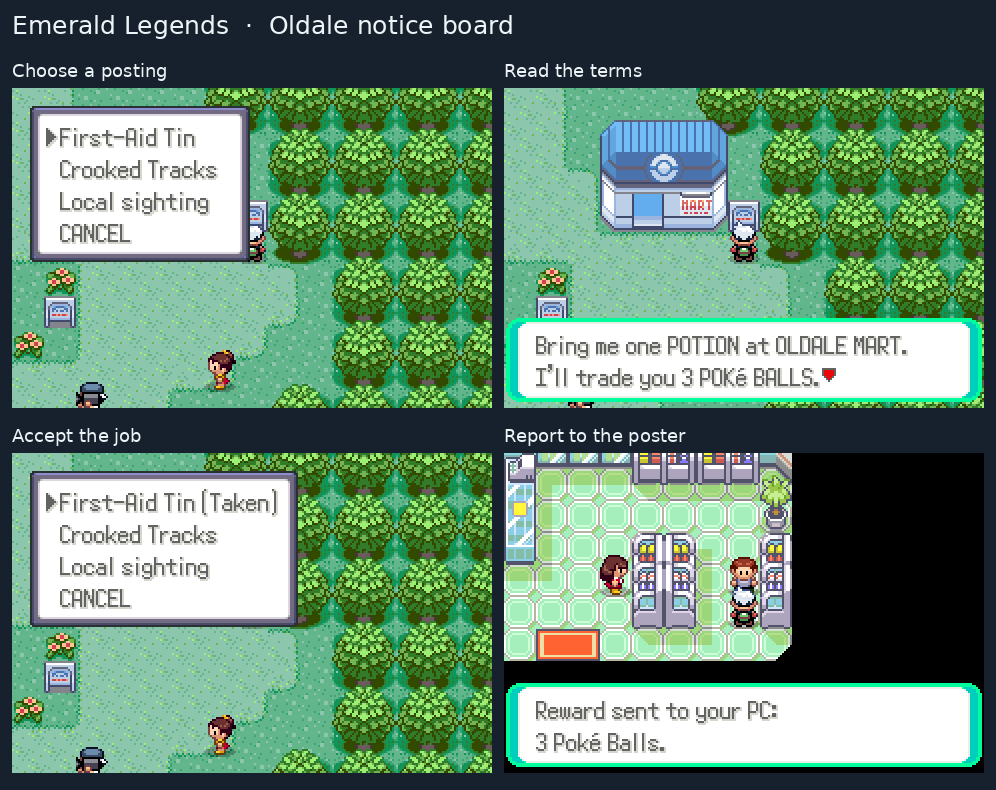

# Town notice boards

The first three boards stand outside the Poké Marts in Oldale, Petalburg and Rustboro. They are independent of Birch's and Devon's requests. A player can take multiple notices, track them in the Quest Log and put unfinished notices back on their board. Each local sighting reads a species category from the nearby route's current wild land table.

| Board | Posting | Recipient and objective | PC reward |
| --- | --- | --- | --- |
| Oldale | First-Aid Tin | Deliver 1 Potion to Finn, the boy in the Mart | 3 Poké Balls |
| Oldale | Crooked Tracks | Show Zigzagoon to Nell, the girl outdoors | 2 Potions |
| Petalburg | Woods Medicine | Deliver 2 Antidotes to Reed, the man in the Mart | 2 Great Balls |
| Petalburg | Pond Portrait | Show Wingull to Pip, the boy by the pond | 2 Net Balls |
| Rustboro | Tunnel Lifeline | Deliver 1 Escape Rope to Len, the Bug Catcher in the Mart | 3 Dusk Balls |
| Rustboro | Echo Lesson | Show Whismur to Kit, the boy at the left desk in the school | 2 Super Potions |

## Verification

- Debug mGBA used ordinary directional input and A to interact with all three placed boards. At Oldale the player browsed a sighting, read Finn's notice, accepted it, spoke directly to him at the Mart, declined once and then delivered the Potion. Native flash save, clear and reload preserved the pending and completed states.
- Controlled Debug fixtures exercised all six transactions, including missing items, Eggs presented as proof, full PC storage, retry, one-time payment and returning a notice. The other five NPC interactions were checked for script and map wiring.
- The journal, field request and missive regression checks passed. The feature appends journal IDs 65–70 and uses twelve audited native flag bits. The save layout stays compatible.
- Built both ROM variants on the v0.0.91 feature branch. The Debug SHA-256 was `f977e2e25d8f3c9f5b74cd7535c15753dbb459a594d52019264256bdbc1aed38`. The Release SHA-256 was `39a66f7b999581498249f23a199ecc49fd534b844974e642ed06391f8c7afc00`. Gameplay captures are from the Debug build.
